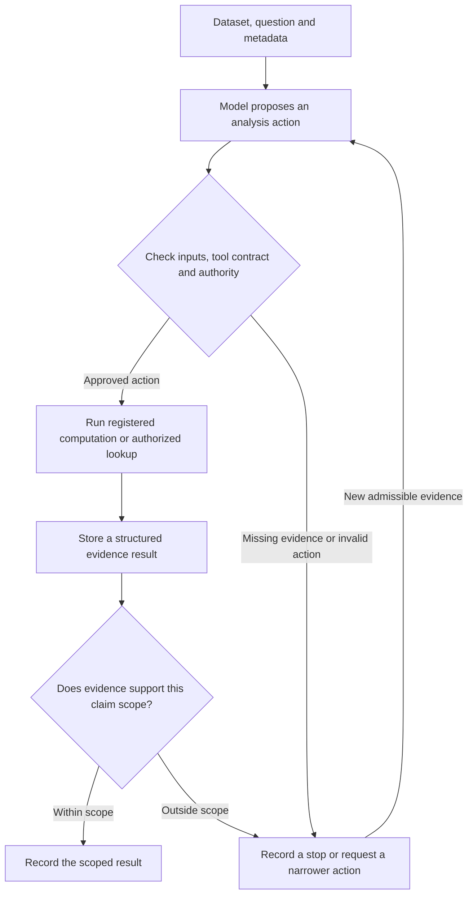

# Dynamics Atlas | Scientific Agent Runtime

An agent for inspecting protein-dynamics evidence. The model proposes a question, action, and draft claim. The runtime checks which data and tools can support that claim, runs authorized work, and keeps the result traceable.

[Engineering case study](https://alex051107.github.io/personal-website/research/dynamics-atlas.html) · [Public literature atlas](https://github.com/alex051107/dynamics-atlas-relaxdb/blob/main/PORTFOLIO.md)

## How the runtime works

**Engineering focus.** Action selection stays with the model. Admission rules, tool contracts, and claim limits stay in code. The public demo shows the decision pattern through recorded replay and synthetic checks.

**Two related artifacts.** This repository is the runtime; the separate RelaxDB atlas is a literature evidence product with its own workflow and release snapshots.

[Public synthetic harness](https://github.com/alex051107/projects/tree/main/scientific_evidence_harness) · [Runtime development notes](https://github.com/alex051107/dynamics-atlas-harness/tree/main)
